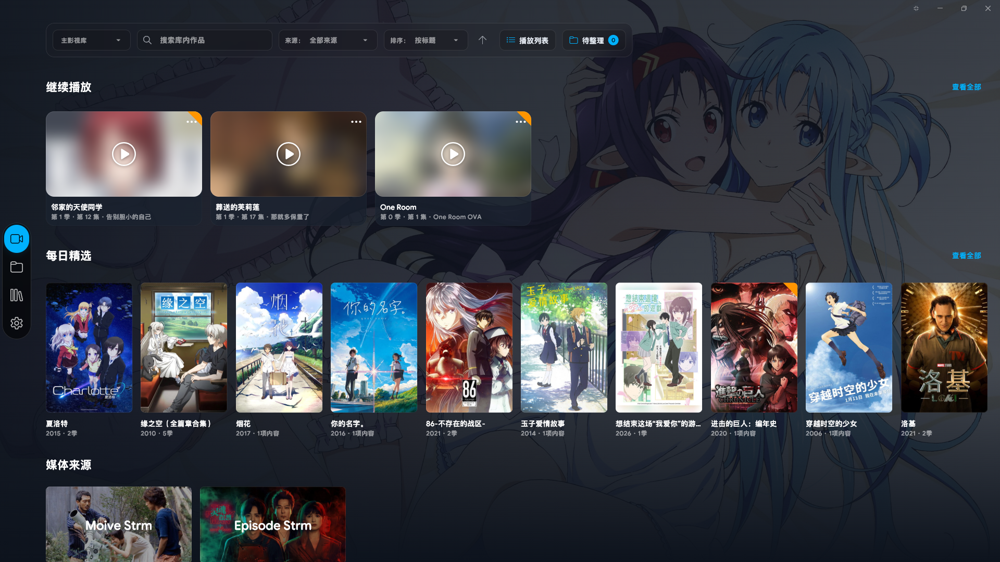
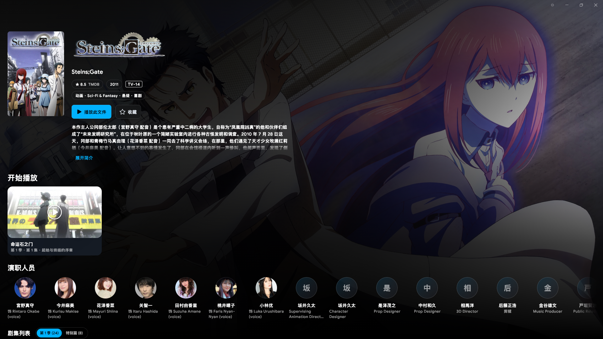
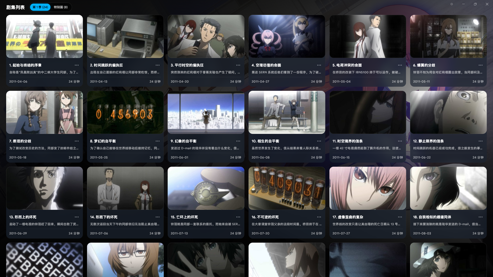
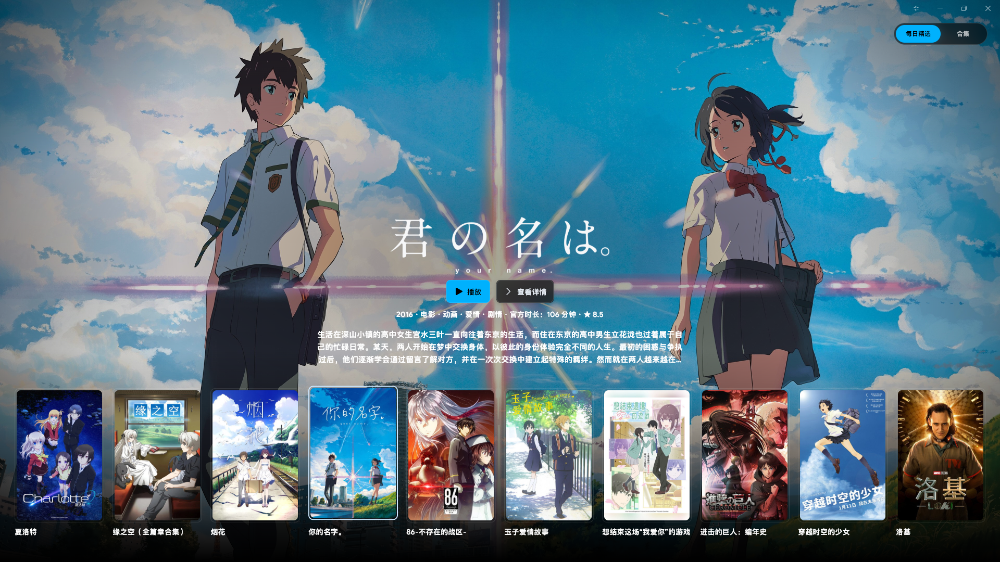

<h1 align="center">StreamPath</h1>

<a href="README.md">简体中文</a> · English

Browse network storage, local media, and media servers on Windows, with playback powered by MPV.

Windows 10/11 x64 · WebDAV / SMB / FTP / NFS · Jellyfin / Emby · Media Library

<a href="#quick-start">Quick Start</a> · <a href="#getting-started-with-the-media-library">Media Library Guide</a> · <a href="docs/PROJECT.md">Technical Details & Compatibility</a>

Media Library Home

<table>
  <tr>
    <td width="50%"></td>
    <td width="50%"></td>
  </tr>
  <tr>
    <td align="center">Title details, cast and crew, and related resources</td>
    <td align="center">Episode browsing, descriptions, and watch progress</td>
  </tr>
</table>

Movie Showcase

## What Can StreamPath Do?

| Feature | Description |
| --- | --- |
| 🎬 Media Library | Browse movies, TV series, collections, daily picks, title details, and episodes. Supports TMDB and local NFO metadata. |
| 🌐 Multiple Sources | Browse WebDAV, SMB, FTP/FTPS, NFS, and local folders, or connect to Jellyfin and Emby. |
| ▶️ Video & Music | Play video, audio, and STRM files using MPV. Supports resume playback, automatic episode transitions, external subtitles and fonts, lyrics, and cover art. |
| 💿 Discs | Blu-ray ISO/BDMV supports main-title playback and optional menus. DVD ISO supports title playlists from local, network, and fully cached sources. |
| 🕘 Favorites & History | Browse favorites, resume playback, and recently played items by source. Import and export selected categories of metadata and personal states. |

The interface supports Simplified Chinese, Traditional Chinese, Japanese, and English. OpenList/AList can be accessed through WebDAV. Features such as search and recovery depend on server capabilities.

## Quick Start

1. Download the Windows x64 installer (`.setup.exe`) from the project's [Releases](../../releases) page and follow the installation wizard. Alternatively, extract the portable package (`.portable.zip`) and run `streampath.exe`.
2. Go to **Settings → Playback** and select your player executable. MPV is recommended.
3. Add a media source:
   - **WebDAV:** Click Add under **Folders → Network Storage**, select WebDAV as the source type, and enter a name, server address, and account credentials. You can optionally specify a default directory or leave the password blank if the server allows it.
   - **Local Folders:** Add a directory under **Folders → Local Folders**.
   - **SMB, FTP/FTPS, NFS:** Select the appropriate protocol in the same **Add Network Storage** dialog and enter the protocol address and account credentials. Configure the SMB domain, NFS version, and UID/GID as needed.
   - **Jellyfin, Emby:** Add a server and account under **Folders → Media Servers**, then select the server at the top of the media library to browse titles and play available versions.
4. Open **Folders**, navigate to your media directory, and click a video, audio, or STRM file to start playback.

Supported media formats depend on the configured player. When playing STRM files hosted on OpenList, enabling **Enable Signing** in the corresponding storage settings is recommended.

Under **Settings → Playback → External Player**, enter one launch argument per line. The `{url}`, `{subfile}`, and `{start}` placeholders are supported. By default, the arguments are injected for every playback session. Disable **Inject All** to inject arguments selectively by category—anime, movies, or TV series. For example, you can enable Anime4K upscaling for anime only. Categories are determined from media library metadata; playback without metadata does not receive category-specific arguments. See [Category-Based Injection of External Player Launch Arguments](docs/外部播放器启动参数分类注入.md) for syntax, examples, and troubleshooting.

On the same settings page, click **Manage Saved MPV Configurations** to edit local options, profiles, keyboard shortcuts, plugin settings, and source files, as well as enable or disable scripts and manage shader reference order. Each change is saved automatically while preserving other original content. **Change History** provides diffs and restoration options. Changes take effect the next time MPV starts.

## Installation & Software Updates

The installed version uses `%LOCALAPPDATA%\Programs\StreamPath` as its default installation directory. It is available only to the current user and does not require administrator privileges. You can change the installation directory or create a desktop shortcut. Uninstalling does not delete user data.

Go to **Settings → General → Software Updates** to view the current version or manually check for updates. The application also checks official Releases on startup and downloads a compatible installer or portable package in the background. Once the download is complete, click **Restart to Update**. Please finish any playback, scanning, or import tasks first. The application will save its state and restart.

Updates preserve the data of the current application copy. Installed and portable versions use separate data directories, and data from other copies is not automatically migrated. Older versions must first be updated manually. Automatic updating is unavailable if a Release lacks the required manifest or a matching package.

## Getting Started with the Media Library

1. Add media sources first. **Main Media Library** aggregates all enabled directories. You can also select Jellyfin or Emby from the dropdown at the top.
2. Go to **Folders → Media Library** and add directories containing movies or TV series.
   Use **Edit Media Directory** to modify the name, source, type, and scanning settings. Local and WebDAV directories also provide options for metadata reading, write-back, and read-only access.
3. Click **Manual Scan**. Once scanning is complete, you can browse your titles.
4. To retrieve metadata from TMDB, save and verify a **Read Access Token** in the media library settings. Scanning and playback remain available without a token.

The top of **Folders → Media Library** displays catalog statistics for enabled directories: **TV Episodes** counts individual episode entries; **TV Series** counts distinct series; **Movies** includes regular movies, ISO images, and BDMV content; and **Other** counts unrecognized entries. Multiple versions of the same movie or episode are counted separately, while entire series are deduplicated by title. Disabled directories and missing resources are excluded. Statistics update automatically after scans or changes to directory enablement.

The media library poster wall can be sorted by title, date added, year, or TMDB rating. Use the control beside the sorting field to switch between ascending and descending order. Titles without a year or rating are placed last.

The media library identifies content from filenames and directory structures. It does not read file contents or probe technical information such as duration and tracks. Including season and episode numbers in filenames improves categorization accuracy.

**Specials** for TV series and **Bonus Features** for movies support category badges and filtering. Under **Settings → Media Library → Bonus Feature Category Management**, you can edit category names and recognition aliases or add custom categories. Use **Change Bonus Feature Type** from a resource's right-click menu to correct its classification manually, or select **Auto Detect** to restore automatic classification. Directories categorized as SCAN/CD are excluded from media resource classification.

For categories, instructions, and naming examples, see the [Bonus Feature Classification System User Guide](docs/特典分类系统使用指南.md).

Go to **Settings → Media Library → Media Library Preferences**, enter comma-separated names in **Excluded Folder Names**, and save. Fuzzy matching checks for keywords, while exact matching requires complete folder names. Both modes are case-sensitive. Matching directories and their subdirectories are excluded from scanning and removed from the catalog during subsequent scans or metadata scraping. To restore them, clear the excluded names and scan again.

The toggle on each directory card enables or disables that media library. When disabled, its associated titles, collections, and source entries are hidden and excluded from playback, episode transitions, and scheduled scans. Personal records are preserved and restored when the directory is re-enabled. Automatic scanning runs once per day by default, with a minimum interval of six hours, and only while the application is idle. You can also scan a specific subdirectory.

**Full-Speed Scan/Scrape** on a directory card supports full scans, incremental scans, scans of specified directories, and standalone metadata scraping. **Scan Multiple Sources** also offers full-speed mode. These functions support local, WebDAV, SMB, FTP, and NFS sources. Before starting, you must acknowledge the risks of cloud-storage rate limits/account restrictions and resource consumption. A full-speed task cannot start during playback or while another scanning/scraping task is running. While it is running, closing the application is the only available interruption option. Closing saves progress; at the next launch, you can resume, postpone, or discard the task. You can also resume a paused task from the media library management page. Jellyfin/Emby continues to use server synchronization.

**Local Metadata Mode** prioritizes existing NFO files and posters while suspending automatic online matching. Network mode falls back to local metadata when online information is unavailable. Metadata write-back is disabled by default and can be enabled in the source settings. Read-only sources and media servers do not support write-back. FTP/FTPS does not support write-back, and existing files are preserved.

Right-click a title to add it to an existing collection or create a new one. The collection management page allows you to edit its name, cover, and members. Deleting a collection does not delete its media. TMDB movie franchises are displayed when at least two titles from the same franchise exist in the library. Jellyfin/Emby collections are refreshed along with their servers. Daily picks and collections can be opened in the **Movie Showcase**, where you can select a title to play or view its details. Use the upper-left back button to return to the previous page. The showcase uses artwork from the selected title as its background, and clicking a cast or crew member's portrait displays their works available in the current library. **Daily Picks** features up to ten titles per day, with a fixed order throughout the day. Transparent logos in the showcase can be sized adaptively to fit their content. Enable this under **Settings → Media Library → Media Library Preferences**; it is disabled by default. When disabled, logos are still automatically centered.

Right-click a title, season, or media resource cover to create a playlist or add it to an existing one. When a title spans multiple sources, you can select a source first. Each playlist is tied to a single source but can contain both movies and TV episodes. Title- and season-based playlists automatically append newly added episodes. Members can also be manually reordered or removed.

Click **Playlists** in the media library toolbar to open the management page. Opening a playlist displays its cover, source, number of entries, and number of titles in the information bar above, along with **Play All**, **Shuffle**, and **Loop Playback** controls. Click an entry to select it, or double-click or use the play button to start playback. Drag the handle to change the order. Menus allow you to remove members, rename playlists, or delete them. Unavailable resources remain in the playlist.

Right-click a playlist or episode cover to refresh metadata, update watched status, or add content to another playlist. Duplicating a playlist preserves its members and order, while duplicating an episode copies only the selected entry. Adding content to an existing playlist skips duplicates. Episodes are sorted by air date or season and episode number. Existing manual ordering is preserved.

Custom playlists require MPV and support videos in the media library, STRM files, and videos available for direct playback from media servers. New playback sessions use the current playlist order. **Shuffle** creates the current session in a randomized order; with **Loop Playback** enabled, playback returns to the first available entry after the last entry finishes. Resumed sessions restore the order captured when playback started. Jellyfin/Emby playlists are read-only; you can create an editable copy using **Copy as Custom Playlist**.

Right-click a title, season, resource, playlist, or Continue Watching cover and select **Cache Video...** to download it after confirming the version, associated files, size, and destination directory. When a complete offline cache is available, playback prioritizes local files. ISO caching downloads the entire disc image, while BDMV caching downloads the complete disc directory. The source must provide reliable file size and version information to support safe download resumption. If there is insufficient storage space, the entire download batch will not start.

The default cache directory is `stream_path_data/video_cache/`. You can change it under **Settings → Cache → Offline Video Cache**, or temporarily select another destination in the download confirmation dialog. The circular download button expands to show download progress, speed, and pause/resume controls. Downloads automatically pause during online playback, and closing the application preserves download progress for later resumption. Downloaded content can be deleted through the management interface in Settings. Regular cache cleanup and media library exports preserve offline video files. For more details, see [Offline Video Cache Documentation](docs/视频离线缓存.md).

The details page provides **Start Playback** or **Resume Playback**. TV series start from S01E01 by default. The Continue Watching and Recently Played menus allow you to refresh playback status or mark content as watched. Right-click an empty area of the media library and select **Refresh Playback Status** to refresh all playback sessions at once. When another episode is available, resume playback automatically advances to the next episode. Media duration is taken from probing results when available; otherwise, official metadata is used.

On a TV series details page, use the selector next to the main play button to choose the default version for the entire series. The selector on the right side of each season row allows you to choose a version for that season independently. These selections persist across application restarts. Selecting a different series-wide version applies it uniformly to all seasons. Each mapped regular episode appears only once, and episodes unavailable in the selected version are hidden. If a version becomes temporarily unavailable, you can manually select another one. For duplicate files that cannot be distinguished automatically, use **Confirm Version Assignment** to assign a version name.

After changing versions, click Play again to apply the selection. Resume playback uses the progress associated with the selected version. When automatic season transitions are enabled and the next season requires a different media source, MPV exits first. The main application then prompts you to choose **Continue Playback** or **Play Later**. The player restarts only if you choose to continue.

Blu-ray ISO/BDMV and DVD ISO support external `.ass`, `.ssa`, and `.srt` subtitles. First enable **Automatically Inject Matching External Subtitles, Fonts, and LRC** under **Settings → Playback → Playback Behavior**. Then open **Disc External Subtitles** from the folder view or playback bottom bar, or **Blu-ray External Subtitles / DVD External Subtitles** from the title window. For each title, choose **Auto Suggest**, **Do Not Use External Subtitles**, or a specific file. See [Naming and Using External Subtitles for ISO and BDMV](docs/ISO与BDMV外挂字幕命名与使用.md) for naming conventions, directory locations, and matching rules.

Go to **Settings → Playback → Playback Behavior** to enable **Insert Specials by Decimal Episode Number** (disabled by default). For recognized TV series, implicit playlists use decimal episode numbers found in special episode metadata titles to insert specials such as Episode 11.5 between the corresponding regular episodes. If the season assignment is unclear or the episode number falls outside the season's range, the original air-date ordering is preserved. Changes take effect when a new playback session starts after saving the setting. Custom playlists retain their original order.

In the same category of settings, **Implicit Playlist Episode Limit** defaults to 2 (the current episode plus the next). You can set it from 2 to 10 to control how many episodes are loaded into MPV at once. Increasing the limit reduces waiting during episode transitions but prepares more episodes in advance, using additional network and cache resources. After saving, the setting applies to newly started or newly reattached sessions. Traditional full playlists are unaffected.

**Spoiler Protection** can be enabled in the media library settings. Covers and descriptions of unwatched titles are masked and can be temporarily revealed using **Reveal Spoilers**. The mask is restored when content is marked as unwatched.

Go to **Settings → Media Library → Media Library Preferences** to enable **Show Season / Movie Counts**. When enabled, the second line of a title's cover displays information such as `2023 · 2 Seasons` or `2023 · 2 Items`. Movie resources include regular video files, STRM, ISO, and BDMV. This option is disabled by default, so only the release year is displayed.

ZIP backups can be imported or exported from the media library settings. Exported files are saved in the `stream_path_data/` root directory. During import, you can select categories and source mappings. Local data takes precedence in case of conflicts, and repeated imports do not create duplicate records. Backups do not include passwords, active players, temporary playback URLs, or custom playlists. Watched status cannot be imported during playback.

Go to **Settings → Interface → Interface Style** to select and save an accent color. Available colors include blue, cyan, green, lime, yellow, orange, pink, magenta, purple, and white. Blue is the default. The white accent appears white in dark mode and uses a distinguishable neutral color in light mode.

## Compatibility & Data Storage

- **Operating System:** Windows 10/11 x64.
- **Player:** MPV is the primary supported player. Other external players can also be used for video and audio playback through configurable player argument templates.
- **Blu-ray:** Supports unencrypted Blu-ray content. DVD ISO uses title playlists, without DVD menus or CSS decryption. Network playback requires random-access Range requests and resource version validation. AACS/BD+ encrypted discs and BD-J are not supported. HDMV menus are available as an optional experimental feature.
- **Portable Data:** Settings, cache, and playback history are stored in the `stream_path_data/` directory alongside the executable by default.
- **Installed Version Data:** Settings, cache, and playback history are stored in `%LOCALAPPDATA%\StreamPath\stream_path_data\`, separately from the installation directory.
- **Media Servers:** Supports direct playback and synchronization of playback progress and watched status. Transcoding, live streaming, and remote control are not supported. Offline records are synchronized after reconnection.
- **Network Protocols:** Playback sources must support random access. Unsupported sources produce an explicit warning instead of triggering a full-file download. See the Blu-ray section above for supported capabilities.

## Warning

This project only manages and plays media provided by users. It does not provide any media content. Movies shown in demonstrations are used solely to showcase media metadata.

For more information about architecture, protocols, and compatibility, see [Technical Details & Compatibility](docs/PROJECT.md).
