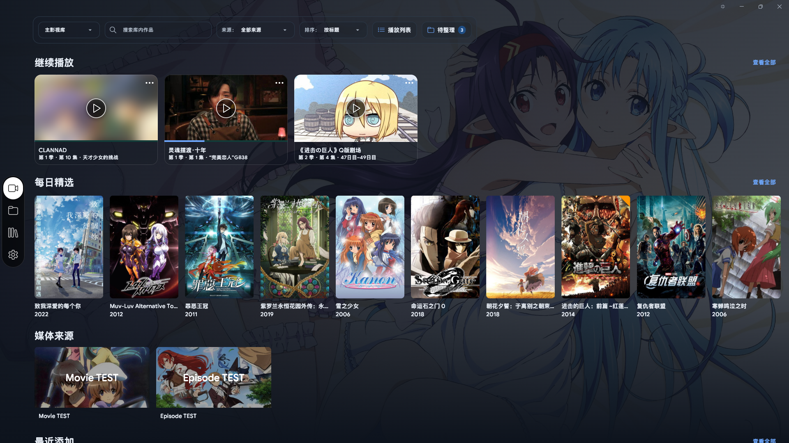

<h1 align="center">StreamPath</h1>

在 Windows 上浏览网络存储、本地媒体和媒体服务器，并使用 MPV 播放。

Windows 10/11 x64 · WebDAV / SMB / FTP / NFS · Jellyfin / Emby · 影视库

<a href="#快速开始">快速开始</a> · <a href="#影视库入门">影视库入门</a> · <a href="docs/PROJECT.md">技术与兼容说明</a>

影视库主页

<table>
  <tr>
    <td width="50%"></td>
    <td width="50%"></td>
  </tr>
  <tr>
    <td align="center">作品详情、演职人员与关联资源</td>
    <td align="center">剧集浏览、简介与观看进度</td>
  </tr>
</table>

影片橱窗页

## StreamPath 能做什么

| 功能       | 说明                                                               |
| -------- | ---------------------------------------------------------------- |
| 🎬 影视库   | 浏览电影、剧集、合集、每日精选、作品详情和分集；支持 TMDB 与本地 NFO 资料。 |
| 🌐 多来源浏览 | 浏览 WebDAV、SMB、FTP/FTPS、NFS 和本地文件夹，也可连接 Jellyfin、Emby。 |
| ▶️ 视频与音乐 | 使用 MPV 播放视频、音频和 STRM；支持续播、自动切集、外挂字幕与字体、歌词和封面。           |
| 💿 蓝光    | 本地 ISO/BDMV 可选菜单或主标题；WebDAV 支持按 Title 播放，HDMV 菜单为测试功能。 |
| 🕘 收藏与历史 | 按来源查看收藏、续播和最近播放；可按类别导入、导出资料与个人状态。 |

支持简体中文、繁体中文、日文和英文。OpenList/AList 可通过 WebDAV 连接，搜索、恢复等功能取决于服务端能力。

## 快速开始

1. 从项目的 [Releases](../../releases) 页面获取 Windows x64 安装包（`.setup.exe`），按向导安装；也可解压便携包（`.portable.zip`）并运行 `streampath.exe`。
2. 在「设置 → 播放」选择播放器可执行文件，推荐使用 MPV。
3. 添加媒体来源：
   - **WebDAV：** 在「文件夹 → 网络存储」点击添加，来源类型选择 WebDAV，填写名称、服务器地址和账号；可按需填写默认目录，允许空密码时可留空。
   - **本地文件夹：** 在「文件夹 → 本地文件夹」添加目录。
   - **SMB、FTP/FTPS、NFS：** 在同一「添加网络存储」弹窗选择对应协议，填写协议地址和账号；按需设置 SMB 域、NFS 版本及 UID/GID。
   - **Jellyfin、Emby：** 在「文件夹 → 媒体服务器」添加服务器和账号，再从影视库顶部选择服务器浏览作品并播放可用版本。
4. 打开「文件夹」，进入媒体目录并点击视频、音频或 STRM 文件播放。

播放器格式支持由所配置的播放器决定。播放 OpenList 上的 STRM 文件时，建议在对应存储设置中启用「启用签名」。

## 安装与软件更新

安装版默认安装到 `%LOCALAPPDATA%\Programs\StreamPath`，仅当前用户可用，无需管理员权限。可更改安装目录或创建桌面快捷方式；卸载不会删除用户数据。

在「设置 → 常规 → 软件更新」查看版本或手动检查。软件启动时也会检查正式 Release，并在后台下载适用的安装版或便携版。下载完成后点击「重启更新」；请先结束播放、扫描和导入，软件会保存状态并重启。

更新保留当前副本的数据；安装版和便携版使用各自的数据目录，不会搬移其他副本的资料。旧版本需先手动升级；Release 缺少发布清单或匹配文件时无法自动更新。

## 影视库入门

1. 先添加媒体来源。「主影视库」汇总已启用的目录；也可从顶部下拉框选择 Jellyfin 或 Emby。
2. 打开「文件夹 → 影视库」，添加电影或剧集目录。
   通过「编辑影视目录」可修改名称、来源、类型和扫描设置；本地／WebDAV 目录还可设置元数据读取、写回和只读。
3. 点击「手动扫描」，完成后即可浏览作品。
4. 需要 TMDB 资料时，在影视库设置中保存并验证 **Read Access Token**；不设置也可扫描和播放。

「文件夹 → 影视库」顶部显示已启用目录的收录统计：「电视剧」为单集条目数，「电视剧集」为整部剧集数，「电影」包含普通电影、ISO 和 BDMV，「其他」为未识别条目。同一电影或单集的多个版本分别计数，整剧按作品去重；停用目录及缺失资源不计入，扫描和目录开关变化后自动更新。

影视库海报墙可按标题、收录时间、年份或 TMDB 评分排序，并可在排序字段右侧切换升序与降序；年份或评分缺失的作品会排在末尾。

影视库根据文件名和目录识别媒体，不读取文件内容或探测时长、轨道等信息。文件名带有季集编号时，更容易正确归类。

在「设置 → 影视库 → 影视库偏好」填写逗号分隔的「屏蔽文件夹名称」并保存。模糊模式按关键字匹配，精确模式按完整名称匹配，均区分大小写。命中目录及子目录会跳过扫描，并在后续扫描或刮削时从清单中移除；清空名称后重新扫描即可恢复。

目录卡片开关用于启用或停用该影视库。停用后，相关作品、合集和来源入口会隐藏，也不参与播放、切集和定时扫描；个人记录会保留，重新启用即可恢复。自动扫描默认每天一次，最短间隔六小时，只在软件空闲时运行；也可指定子目录扫描。

本地元数据模式优先使用现有 NFO 和海报，并暂停自动网络匹配；网络模式在网络资料缺失时读取本地资料。写回默认关闭，可在来源设置开启。只读来源和媒体服务器不会写回；FTP/FTPS 不支持写回，已有文件会保留。

右键作品可加入或创建合集，管理页可修改名称、封面和成员；删除合集不会删除媒体。TMDB 电影系列在库内至少有两部作品时显示，Jellyfin/Emby 合集随服务器刷新。每日精选和合集可进入影片橱窗，选择作品播放或查看详情，左上角返回上一级。橱窗以作品图片为背景，演职人员头像可查看本库作品；每日精选每天最多十部，当天顺序固定。橱窗中的透明 Logo 可按内容自适应大小，可在「设置 → 影视库 → 影视库偏好」开启，默认关闭；关闭时仍自动居中显示。

右键作品、季或资源封面，可创建或加入播放列表。跨来源作品可先选择来源；每个列表固定一个来源，可混合电影和剧集。作品／季列表会自动追加新集，也可手动排序和移除成员。

点击影视库工具栏的「播放列表」进入管理页；点入列表后，上方信息栏显示封面、来源、条目与作品数，并提供「全部播放」「随机播放」「循环播放」。单击选择条目，双击或点击播放按钮起播；拖动手柄调整顺序。菜单可移除成员、重命名或删除列表；不可用的资源仍会保留。

右键列表或单集封面，可刷新资料、标记观看状态或加入其他列表。复制列表会保留成员和顺序，复制单集只复制当前条目；加入已有列表时会跳过重复项。集数按首播日期或季集号排序，手动顺序保持有效。

自定义播放列表需要 MPV，支持库内视频、STRM 和服务器直播放视频。新播放使用当前列表顺序；「随机播放」按打乱后的顺序建立本次会话；开启「循环播放」后，末项结束会回到首个可用条目继续。续播恢复开始播放时的顺序。Jellyfin/Emby 列表为只读；复制为自定义列表后可编辑。详见[自定义播放列表说明](docs/影视库自定义播放列表.md)。

右键作品、季、资源、播放列表或继续播放封面，选择「缓存视频…」，确认版本、附件、容量和保存目录后下载。完整缓存播放时优先使用本地文件，ISO 下载完整镜像，BDMV 下载整盘目录。来源必须提供可安全续传的大小和版本信息；空间不足时整批不会开始。

默认目录为 `stream_path_data/video_cache/`，可在「设置 → 缓存 → 视频离线缓存」修改，或在确认窗口临时选择。圆形下载按钮可展开进度、速度和暂停／继续操作；在线播放期间自动暂停，关闭软件保留断点。设置中的管理入口可删除下载，普通缓存清理和库导出会保留视频文件。详见[视频离线缓存说明](docs/视频离线缓存.md)。

详情页提供「开始播放」或「继续播放」；剧集默认从 S01E01 起播。继续播放和最近播放菜单可刷新状态或标记已看完；影视库空白处右键选择「刷新播放状态」可统一刷新播放会话。有下一集时续播自动推进。时长优先显示探测结果，否则使用官方资料。

剧集详情页的播放按钮右侧可选择全剧默认版本，季列表右侧可单独选择当前季版本；选择在重启后保留。重新选择全剧版本会统一各季。已映射的普通剧集每集仅显示一次，所选版本缺失的集数隐藏；版本暂时不可用时可手动改选。无法自动区分的重复文件可通过「确认版本归属」指定名称。

切换版本后再次点击播放生效，续播使用该版本自己的进度。开启自动切季后，下一季需要其他来源时，MPV 先退出，主程序再提示「继续播放」或「稍后播放」；选择继续才重新启动播放器。

蓝光 ISO／BDMV 支持外挂 `.ass`、`.ssa`、`.srt` 字幕：先在「设置 → 播放 → 播放行为」开启「自动注入匹配的外挂字幕、外挂字体与 LRC」，再在文件夹右键菜单、ISO 标题选择窗口或播放底栏点击「蓝光外挂字幕」，为每个 MPLS 选择「自动建议」「不使用外挂字幕」或指定文件。命名、目录位置与匹配规则见 [ISO 与 BDMV 外挂字幕命名与使用](docs/ISO与BDMV外挂字幕命名与使用.md)。

在「设置 → 播放 → 播放行为」可开启「按小数集号插入番外篇」（默认关闭）。已识别剧集的隐式播放列表会根据特别篇元数据标题中的小数集号，将 11.5 集等插入对应正片之间；季归属不明确或集号超出季范围时保留首播排序。保存后重新起播生效，自定义列表保留原顺序。

同一分类的「隐式播放列表集数上限」默认 2（当前集加下一集），可填 2～10，表示同时挂入 MPV 的集数。调大后切集更少等待，但会提前准备更多集数并占用更多网络与缓存；保存后对重新起播或重新接管的会话生效，传统完整列表不受影响。

在影视库设置中可启用「防剧透」遮罩；未看完的封面和简介可用「展示剧透」临时揭示，标记未观看后恢复遮罩。

在「设置 → 影视库 → 影视库偏好」开启「显示季数／影片数」，作品封面第二行会显示如 `2023·2季` 或 `2023·2项内容`；电影资源包含普通视频、STRM、ISO 和 BDMV。默认关闭，仅显示年份。

可在影视库设置中导入或导出 ZIP 备份，文件保存在 `stream_path_data/` 根目录。导入时选择类别和来源映射；冲突保留本机资料，重复导入不会产生重复记录。备份不含密码、活动播放器、临时播放地址或自定义播放列表；播放期间不能导入观看状态。

在「设置 → 界面 → 界面样式」选择强调色并保存，提供蓝色、青色、绿色、青柠绿、黄色、橙色、粉色、洋红色、紫色和白色，默认蓝色；白色在深色界面显示为白色，浅色界面采用易辨识的中性色。

## 支持范围与数据

- **系统：** Windows 10/11 x64。
- **播放器：** MPV 是主要支持目标；视频和音频也可按播放器参数模板使用其他外部播放器。
- **蓝光：** 支持未加密 Blu-ray。WebDAV 播放需要服务器支持随机 Range 读取和资源版本校验；DVD、AACS/BD+ 加密碟片及 BD-J 不在支持范围内。HDMV 菜单为可选测试功能。
- **便携数据：** 配置、缓存和播放记录默认保存在程序同级的 `stream_path_data/` 目录。
- **安装版数据：** 配置、缓存和播放记录保存在 `%LOCALAPPDATA%\StreamPath\stream_path_data\`，与安装目录分开。
- **媒体服务器：** 支持直接播放及进度、观看状态同步，不提供转码、直播或远程控制。离线记录会在重连后同步。
- **网络协议：** 播放来源需支持随机读取；不支持的来源会明确提示，不会整片下载。蓝光支持范围见上。

## 警告

本项目仅管理和播放用户提供的媒体，不提供片源；演示影片仅用于展示影视资料。

更多架构、协议和兼容细节见[技术与兼容说明](docs/PROJECT.md)。
